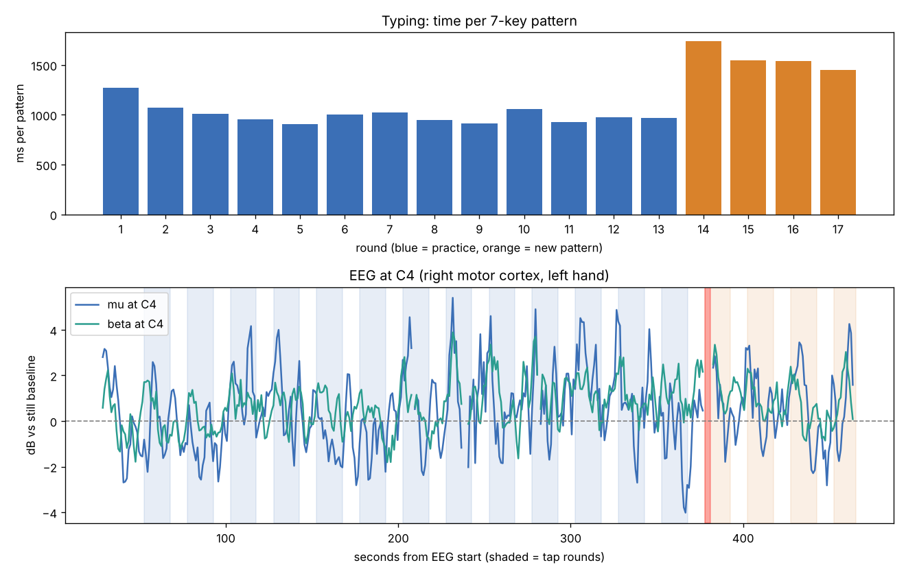

# Finger tapping sequence learning

Neurotech hackathon, Team 6. We record EEG while someone learns a new finger-tapping pattern, then check whether the motor cortex signal changes as the skill gets learned.



## What's here

| Folder | What it holds |
| --- | --- |
| `task/finger_tapping.html` | The tapping task. Open it in a browser; it logs every keypress with a Unix ms timestamp. |
| `processing/analyze_tapping_eeg.py` | Lines up the EEG with the tapping log and measures band power per round. |
| `results/P01_session3/` | Round times, band power, pooled tests, a clock check and a summary figure. |
| `docs/finger_tapping_protocol.md` | Step by step for the handwriting and tapping tasks. |

Raw EEG is not in this repo. Participants are listed by ID only.

## Running the analysis

Needs `mne`, `antio`, `scipy`, `numpy` and `matplotlib` (add any missing ones to `environment.yml`).

```bash
python processing/analyze_tapping_eeg.py \
  --eeg path/to/recording.cnt \
  --blocks results/P01_session3/tapping_blocks.csv \
  --out results/P01_session3 \
  --exclude 377.7-381.0
```

- `--blocks` is the **Blocks CSV** from the tapping page (Details and export).
- `--exclude` drops stretches of EEG, in seconds from the start of the recording (a cough, someone talking).
- Works with ANT Neuro `.cnt` files directly, and with any format MNE can open.

## First result (P01, session 3, 2026-11-07)

**Typing:** clear, pattern-specific learning. Time per 7-key pattern fell from 1,273 ms in round 1 to about 981 ms in rounds 10 to 13 (23% faster). On the new pattern in round 14 it jumped to 1,739 ms, slower than round 1.

**EEG:** the expected motor signal was not there. Mu (8 to 12 Hz) and beta (13 to 30 Hz) at C3 and C4 should drop while tapping compared with rest. In this session they did not; beta at C4 went up 16% instead. The likely cause is that rests were not clean: muscle and eye activity differ between tap and rest periods. See `results/P01_session3/pooled.csv`.

**Clock check:** 73% of the largest movement artifacts fall 0 to 4.5 s after a round starts (about 18% would by chance), so the laptop and EEG clocks agree.

This is one person and one session: a pilot, not a conclusion.

## Next run

- Turn off live feedback on the tapping page (Settings), so the eyes stay still.
- During rests: eyes on one spot, hands still, no talking.
- Add a few 30 s still periods between rounds.
